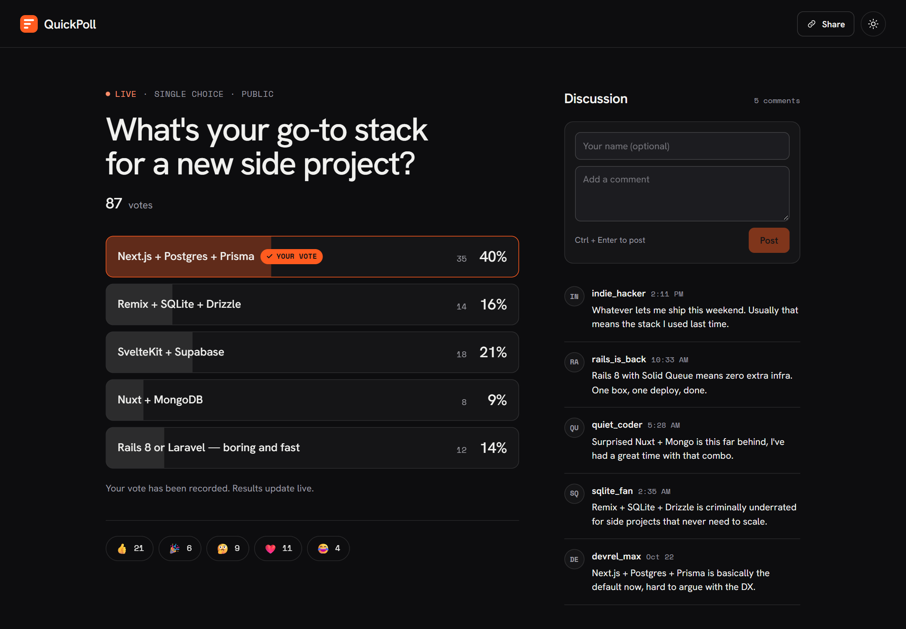
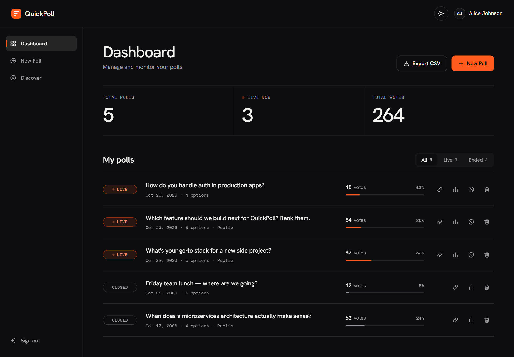
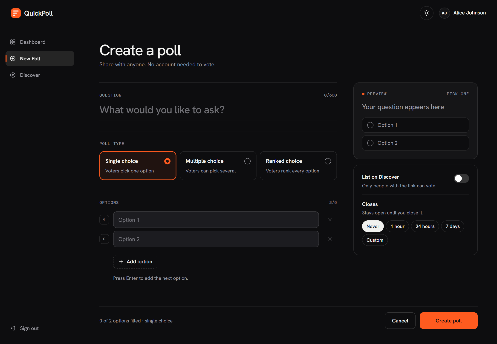
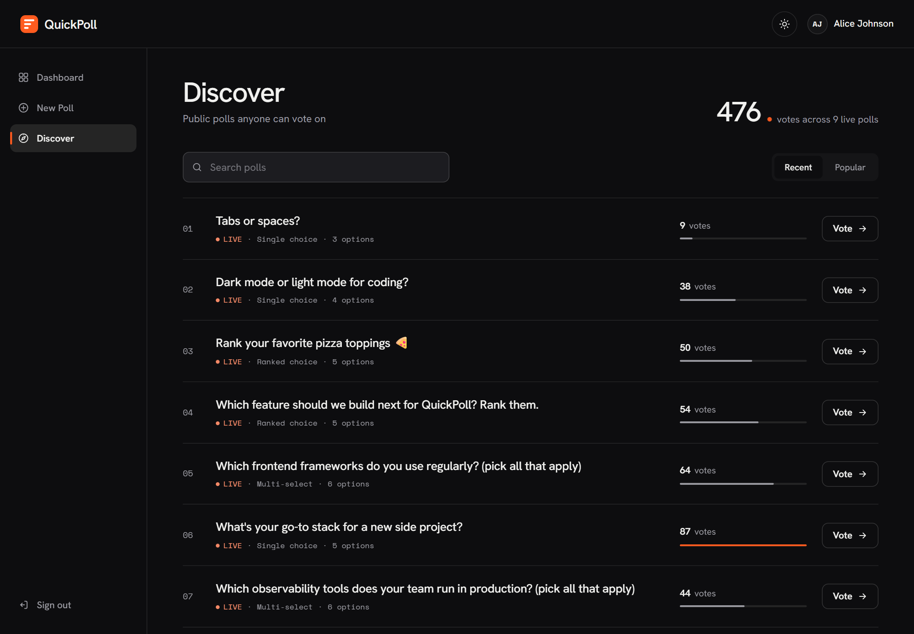
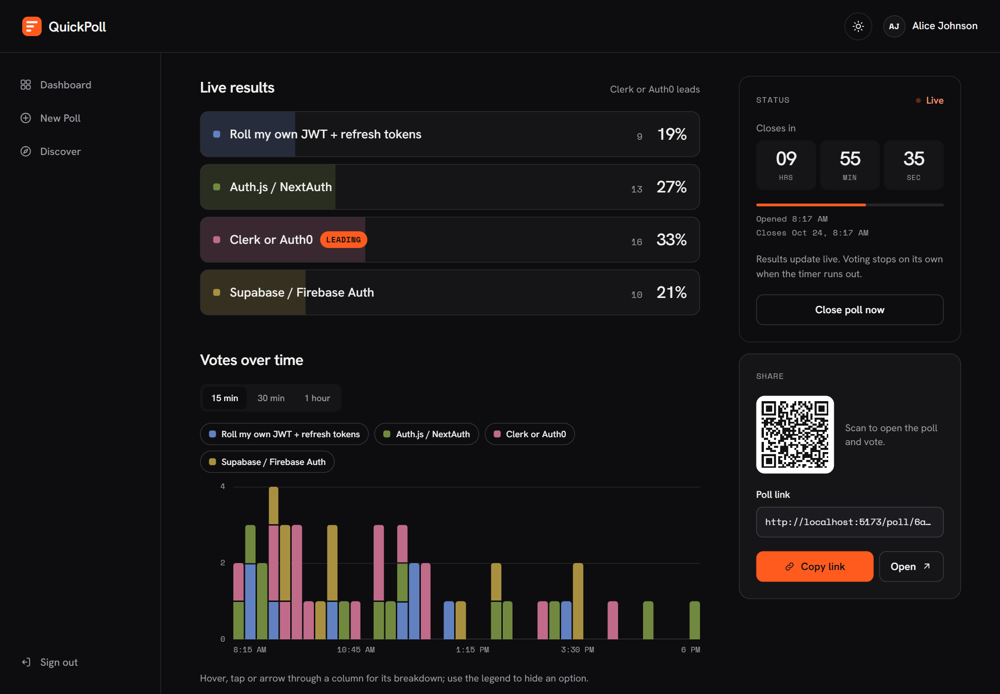
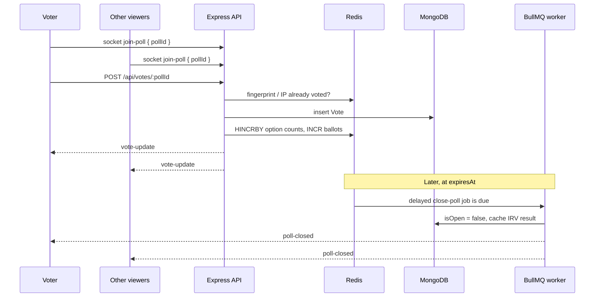
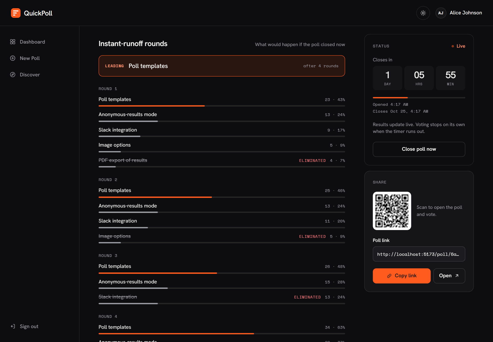

<div align="center">


# QuickPoll

**Real-time polls with live results, ranked-choice voting, and zero sign-up for voters.**

Built with the MERN stack, TypeScript, Socket.io, Redis, and BullMQ.


[Features](#features) · [Screenshots](#screenshots) · [Quick start](#quick-start) · [How it works](#how-it-works) · [API](#api-reference)

<br />



</div>

---

## Overview

Creators sign in, build a **single-choice, multi-select, or ranked-choice** poll, optionally set an expiry, and share the link or a QR code. Polls can also be listed on a public **Discover** feed.

Voters don't need an account. They open the link, vote once (enforced by browser fingerprint and IP), react with emoji, and join the discussion. Every change reaches every open tab instantly over Socket.io. When a poll's timer runs out, a BullMQ job closes it on the dot and notifies everyone watching.

---

## Features

**For voters**

- **Three ballot types**: pick one, pick several, or drag every option into order (ranked choice, via `@dnd-kit`)
- **Live results**: bars update the moment anyone votes, with confetti when your own vote lands
- **Reactions and comments**: a fixed emoji bar (reactions can be taken back) and an anonymous discussion thread, both live
- **One vote per person**: fingerprint and IP dedup in Redis, checked on page load so returning voters go straight to results

**For creators**

- **Dashboard**: all your polls with live/ended filters, vote totals, and one-click close, delete, or share
- **CSV export**: one row per option across every poll you own
- **Analytics**: unique voters, peak 15-minute window, a per-option *votes over time* chart (15 min / 30 min / 1 hour), and a QR code for projecting
- **Instant-runoff breakdown**: ranked polls show every elimination round, both "if it closed now" and the final result
- **Auto-close**: set 1 hour, 24 hours, 7 days, or a custom time, and the poll closes itself
- **Discover**: opt a poll into the public feed, searchable and sortable by recent or popular

**Throughout**

- Light and dark themes, with a circular reveal from the toggle (View Transitions API)
- Responsive layout with a mobile bottom nav
- Animated page transitions, rolling numbers, skeleton states, and toasts (Framer Motion)
- A one-click demo account on the sign-in page, and demo data seeded automatically on first boot

---

## Screenshots

<table>
  <tr>
    <td width="50%"><p align="center"><b>Dashboard</b>: your polls, live counts, and quick actions</p></td>
    <td width="50%"><p align="center"><b>Create poll</b>: choose the ballot type, expiry, and visibility</p></td>
  </tr>
  <tr>
    <td width="50%"><p align="center"><b>Discover</b>: public polls anyone can vote on</p></td>
    <td width="50%"><p align="center"><b>Analytics</b>: live results, timeline, countdown, and QR share</p></td>
  </tr>
</table>

---

## Tech stack

| Layer            | Tech                                                                        |
| ---------------- | --------------------------------------------------------------------------- |
| Frontend         | TypeScript, React 19, React Router 7, Tailwind CSS 3, Vite 6                |
| Animation        | Framer Motion 11 (the results bars and timeline chart are hand-built, no chart library) |
| Drag and drop    | @dnd-kit (ranked-choice ballots)                                            |
| HTTP client      | Axios with a JWT interceptor                                                |
| Real-time        | Socket.io 4.8, with typed event maps on client and server                   |
| Backend          | TypeScript, Express 5, Node.js (ESM)                                        |
| Database         | MongoDB via Mongoose 9                                                      |
| Cache / counters | Redis via ioredis 5                                                         |
| Job queue        | BullMQ 5                                                                    |
| Auth             | JWT (jsonwebtoken 9) + bcryptjs                                             |
| Fingerprinting   | @fingerprintjs/fingerprintjs 4                                              |
| Extras           | canvas-confetti, qrcode                                                     |

`client/` and `server/` are independent TypeScript projects with no shared workspace. The server compiles with `tsc` to `dist/` for production, and the client build runs `tsc --noEmit` before `vite build`.

---

## Quick start

### Prerequisites

- Node.js 20+
- MongoDB (local or Atlas)
- Redis (local, Docker, Upstash, or Redis Cloud)

### 1. Install

```bash
cd server && npm install
cd ../client && npm install
```

### 2. Configure

**`server/.env`**

```env
PORT=5000
MONGODB_URI=mongodb://127.0.0.1:27017/quickpoll
JWT_SECRET=your_super_secret_key_minimum_32_characters
JWT_EXPIRY=7d
REDIS_URL=redis://localhost:6379
CLIENT_URL=http://localhost:5173
NODE_ENV=development
```

**`client/.env`**

```env
VITE_API_URL=http://localhost:5000/api
VITE_SOCKET_URL=http://localhost:5000
```

| Variable         | Where  | Notes                                                                 |
| ---------------- | ------ | --------------------------------------------------------------------- |
| `CLIENT_URL`     | server | Allowed CORS origin(s), comma-separated; a bare host is treated as `https://` |
| `SEED_DEMO_DATA` | server | Set to `false` to skip seeding demo data into an empty database      |
| `VITE_*`         | client | Baked in at build time, so rebuild the client after changing them      |

> No Redis locally? `docker run -d -p 6379:6379 redis:7-alpine` is enough.

### 3. Run

```bash
# Terminal 1: API + Socket.io + BullMQ worker (tsx watch, no build step)
cd server && npm run dev

# Terminal 2: Vite dev server
cd client && npm run dev
```

Open **http://localhost:5173** and click **Try the demo account**.

### 4. Demo data

On startup the server seeds demo data automatically if the database has **no users**. Existing data is never touched. To reset to a clean demo at any time:

```bash
cd server && npm run seed   # wipes all collections first, then reseeds
```

The demo set is 5 accounts and 20 polls, with about 900 votes, 50 comments, and 550 reactions. It covers every ballot type; live, expiring, manually closed, and auto-expired polls; public and private polls; and one brand-new poll with no votes. Vote timelines spike at launch and taper off, and the pizza poll is built so the first-round leader loses the instant runoff. Generation is deterministic (seeded PRNG), and the poll content lives in [`server/src/demo/content.ts`](server/src/demo/content.ts).

| Email                | Password      |
| -------------------- | ------------- |
| `alice@example.com`  | `password123` |
| `bob@example.com`    | `password123` |
| `carol@example.com`  | `password123` |
| `priya@example.com`  | `password123` |
| `marcus@example.com` | `password123` |

### 5. Test

```bash
cd server && npm test   # node:test, covering instant-runoff, timeline bucketing, and the demo generator
```

### 6. Build and deploy

```bash
cd server && npm run build && npm start   # compiles to dist/, then runs it
cd client && npm run build                # tsc --noEmit && vite build → client/dist/
```

The repo includes [`render.yaml`](render.yaml) (a Render Blueprint for the server) and [`client/vercel.json`](client/vercel.json) (SPA rewrites for Vercel). On the server, set `CLIENT_URL` to the frontend's origin. On the client, set `VITE_API_URL` and `VITE_SOCKET_URL` to the server's URL, then **redeploy the client**, or the build will still point at `localhost:5000`.

---

## How it works



### Casting a vote

1. The voter opens `/poll/:id`. The client fetches the poll with its live counts, asks `/api/votes/:id/status` whether this browser has already voted, and joins the poll's Socket.io room.
2. `POST /api/votes/:id` checks the fingerprint and IP keys in Redis (`VOTE_GUARD`), writes the ballot to MongoDB, then runs `HINCRBY` on every selected option and increments a separate ballots counter.
3. The server emits `vote-update` to the room, and every open tab animates its results.

The ballots counter exists because a multi-select ballot bumps several options at once, so summing option counts would overstate the number of voters.

### Ranked-choice tallying



1. Each ballot is stored as a full ranking (`rankings: number[]`). Its first preference also feeds the normal Redis live counts while the poll is open.
2. [`utils/irv.ts`](server/src/utils/irv.ts) runs instant-runoff voting over the stored ballots. Each round it eliminates the lowest-tallied option and moves those ballots to their next preference, until one option holds a strict majority of the ballots still in play or only one option remains.
3. Analytics computes this on demand ("what would happen if the poll closed now"). At close time the result is computed once and cached on `Poll.finalResult`, so the public page can show the outcome without recomputing it.

### Auto-close

1. Creating a poll with `expiresAt` schedules `pollExpiryQueue.add('close-poll', { pollId }, { delay })`.
2. When the job fires, the shared `finalizePollClose` sets `isOpen: false`, computes and caches the IRV result for ranked polls, and emits `poll-closed`.
3. Every viewer's ballot locks immediately. Manual closes through `PATCH /api/polls/:id/close` run the same code path.

### Analytics timeline

Votes are bucketed into 15-minute windows aligned to UTC ([`utils/timeline.ts`](server/src/utils/timeline.ts)). Every time zone in use is offset from UTC by a whole number of quarter hours, so the client can regroup buckets into 30-minute or hourly windows in the viewer's local time without splitting any of them.

---

## API reference

Base URL: `/api`. 🔒 means a `Bearer` JWT is required.

### Auth

| Method | Path             | Body                        |
| ------ | ---------------- | --------------------------- |
| POST   | `/auth/register` | `{ name, email, password }` |
| POST   | `/auth/login`    | `{ email, password }`       |

### Polls

| Method | Path                     | Auth | Notes                                                                 |
| ------ | ------------------------ | ---- | --------------------------------------------------------------------- |
| GET    | `/polls/discover`        |      | `?page=&limit=&sort=recent\|popular&q=`                               |
| GET    | `/polls/:id`             |      | Poll with live counts and `totalVotes`                                 |
| GET    | `/polls`                 | 🔒   | The creator's own polls                                                |
| POST   | `/polls`                 | 🔒   | `{ question, options[], pollType?, isPublic?, expiresAt? }`           |
| PATCH  | `/polls/:id/close`       | 🔒   | Owner only                                                             |
| DELETE | `/polls/:id`             | 🔒   | Owner only                                                             |
| GET    | `/polls/:id/analytics`   | 🔒   | Owner only: `totalVotes`, `uniqueVoters`, `timeline`, `irv`           |
| GET    | `/polls/export/csv`      | 🔒   | CSV of every poll the creator owns, one row per option                 |

`pollType` is `'single' | 'multi' | 'ranked'` (default `'single'`). A poll has 2–6 options and a question of up to 300 characters.

### Votes

| Method | Path                    | Body / query                                                  |
| ------ | ----------------------- | ------------------------------------------------------------- |
| GET    | `/votes/:pollId`        | Live counts                                                   |
| GET    | `/votes/:pollId/status` | `?fingerprint=` → `{ voted }`                                 |
| POST   | `/votes/:pollId`        | Single: `{ optionIndex, fingerprint? }`                       |
|        |                         | Multi: `{ optionIndexes: number[], fingerprint? }`            |
|        |                         | Ranked: `{ rankings: number[], fingerprint? }`, a full permutation of the option indexes |

A repeat vote returns `409`.

### Comments and reactions

| Method | Path                               | Auth | Notes                                                   |
| ------ | ---------------------------------- | ---- | ------------------------------------------------------- |
| GET    | `/polls/:id/comments`              |      | `?page=&limit=`                                         |
| POST   | `/polls/:id/comments`              |      | `{ authorName, body }`: name ≤ 40 chars, body ≤ 500     |
| DELETE | `/polls/:id/comments/:commentId`   | 🔒   | Poll owner only                                         |
| GET    | `/polls/:id/reactions`             |      | `?fingerprint=` → `{ reactions, mine }`                 |
| POST   | `/polls/:id/reactions`             |      | `{ emoji, fingerprint? }`; a repeat reaction returns `409` |
| DELETE | `/polls/:id/reactions/:emoji`      |      | `?fingerprint=`, takes a reaction back                  |

Also: `GET /api/health` for uptime checks.

### Socket.io events

| Direction        | Event             | Payload                                                  |
| ---------------- | ----------------- | -------------------------------------------------------- |
| Client → Server  | `join-poll`       | `{ pollId }`                                             |
| Server → Client  | `vote-update`     | `{ pollId, counts: [{ optionIndex, count }], totalVotes }` |
| Server → Client  | `poll-closed`     | `{ pollId, finalResult?: { winnerIndex, rounds } }`      |
| Server → Client  | `comment-added`   | `{ _id, pollId, authorName, body, createdAt }`           |
| Server → Client  | `reaction-update` | `{ pollId, reactions: [{ emoji, count }] }`              |

### Redis keys

| Key                                 | Type   | Purpose                                  |
| ----------------------------------- | ------ | ---------------------------------------- |
| `poll::{pollId}::counts`            | Hash   | Live vote count per option               |
| `poll::{pollId}::ballots`           | String | True ballot count (safe for multi-select) |
| `poll::{pollId}::reactions`         | Hash   | Live reaction count per emoji            |
| `vote::{pollId}::{fingerprint}`     | String | Vote dedup by fingerprint, 30-day TTL    |
| `vote::{pollId}::{ip}`              | String | Vote dedup by IP, 30-day TTL             |
| `reaction::{pollId}::{emoji}::{fp}` | String | Reaction dedup by fingerprint            |
| `reaction::{pollId}::{emoji}::{ip}` | String | Reaction dedup by IP                     |

### Feature flags

```ts
// server/src/config/features.ts
export const FEATURES = {
  VOTE_GUARD: true, // one vote per person via fingerprint + IP (also gates reaction dedup)
} as const;

export const REACTION_EMOJIS = ['👍', '🎉', '🤔', '❤️', '😂'] as const;
```

---

## Security

- Passwords are hashed with bcrypt (cost 12), and `toJSON()` strips the hash from every user response.
- The JWT is verified on every protected request, and the user is re-fetched from the database.
- Ownership is checked server-side before close, delete, analytics, and comment moderation.
- Rate limits: auth at 20 requests per 15 min; public and voting endpoints at 100 per minute; comment posting at 10 per minute.
- CORS and the Socket.io server accept only the origins in `CLIENT_URL`.
- `trust proxy` is set, so behind a hosting proxy the rate limiter and `VOTE_GUARD` see the real client IP.

---

## Project structure

<details>
<summary>Expand</summary>

```
quickpoll/
├── assets/                          # README screenshots
├── render.yaml                      # Render Blueprint for the server
├── client/
│   ├── vercel.json                  # SPA rewrites
│   └── src/
│       ├── types/                   # api.ts (DTOs), socket.ts (event maps)
│       ├── context/                 # AuthContext, ThemeContext, ToastContext
│       ├── utils/
│       │   ├── api.ts               # axios + JWT interceptor
│       │   ├── socket.ts            # singleton, typed socket.io-client
│       │   └── time.ts              # local-time formatting
│       ├── pages/
│       │   ├── Login.tsx            # sign-in + sign-up with a live product showcase
│       │   ├── Dashboard.tsx
│       │   ├── CreatePoll.tsx
│       │   ├── PollView.tsx         # public voter page
│       │   ├── PollAnalytics.tsx    # creator-only stats
│       │   └── PollDiscovery.tsx    # public poll browsing
│       └── components/
│           ├── Layout.tsx           # header, sidebar, mobile bottom nav
│           ├── VoteTimeline.tsx     # votes-over-time chart
│           ├── RunoffResult.tsx     # instant-runoff rounds
│           ├── RankedChoiceVoter.tsx # @dnd-kit drag-to-rank ballot
│           ├── ReactionBar.tsx
│           ├── CommentSection.tsx
│           ├── CountdownTimer.tsx
│           ├── QRCode.tsx
│           ├── ThemeToggle.tsx / ThemeButton.tsx
│           ├── Logo.tsx, QpToast.tsx, PageTransition.tsx, RouteErrorBoundary.tsx
│           ├── motion/              # AuroraBackground, NavIcon, RollingNumber, variants
│           └── shared/              # Spinner, EmptyState, ErrorMsg
│
└── server/
    └── src/
        ├── index.ts                 # Express + Socket.io + worker boot
        ├── types/                   # models.ts, socket.ts, express.d.ts
        ├── config/
        │   ├── db.ts, redis.ts, bullmq.ts
        │   ├── socket.ts            # setIO / getIO (avoids circular imports)
        │   └── features.ts          # VOTE_GUARD flag, reaction emoji set
        ├── models/                  # User, Poll, Vote, Comment, Reaction
        ├── middleware/              # auth (JWT), rateLimiter
        ├── controllers/             # auth, poll, vote, comment, reaction
        ├── routes/                  # auth, polls (incl. discover, comments, reactions), votes
        ├── socket/pollHandler.ts    # join-poll room logic
        ├── workers/pollWorker.ts    # BullMQ auto-close worker
        ├── utils/
        │   ├── irv.ts               # instant-runoff tallying (tested)
        │   ├── timeline.ts          # 15-min vote buckets (tested)
        │   └── http.ts
        ├── demo/                    # content.ts (poll specs), generate.ts (seeded builder)
        └── seed.ts                  # npm run seed: wipe + reload demo data
```

</details>
